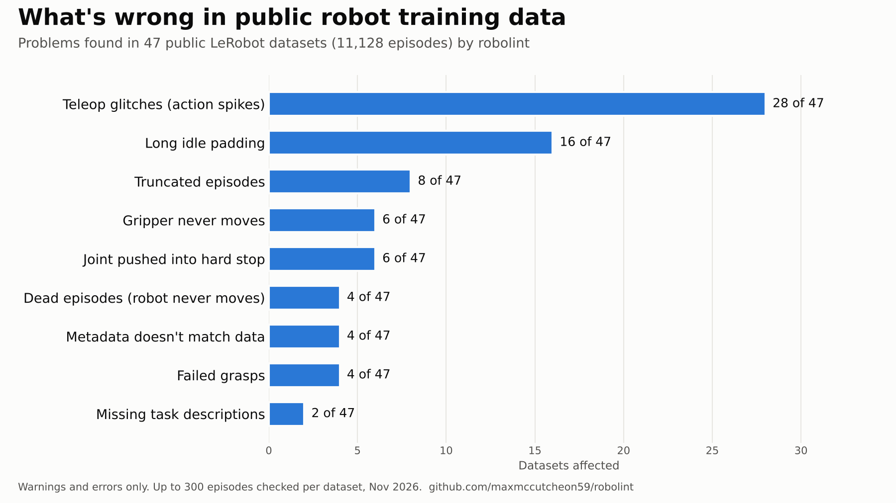

# Robot data audit #2: 47 more public LeRobot datasets

*robolint on 47 real-world LeRobot datasets from companies, research labs and the community:
11,128 episodes, up to the first 300 of each. November 2026.*

The [first audit](AUDIT.md) looked at 18 of the most-downloaded LeRobot datasets. This one goes
wider: data released by robotics companies, research labs, the RoboCOIN multi-robot collection,
and community recordings on SO-100/SO-101, YAM and ALOHA-style arms.



## Short version

- **Most datasets are in good shape.** 30 of 47 grade A and 9 grade B. Only 142 of 11,128
  episodes (1.3%) have errors that make them unusable for training, and they sit in 11 datasets.
- **The problems that do exist are concentrated, and they are structural.** Three community
  datasets have recordings stacked under the same episode numbers or metadata that no longer
  matches the data. We would not train on them as published.
- **Glitches and dead time are everywhere.** 28 of 47 datasets have single-step teleop glitches
  (action spikes) and 16 have long idle stretches at the start or end of episodes. Neither breaks
  training; both quietly bias it.
- **Large conversions carry metadata debt.** Two big converted datasets have duplicate or missing
  global indices, unknown task ids or empty task descriptions.

## Datasets with the most serious problems

| Dataset | Grade | Episodes with errors | What's wrong |
|---|:---:|---:|---|
| EPITECH-LILLE/eval_training | F (39.9) | 21 of 60 (35%) | Episodes 0–19 each hold two recordings stacked under one episode number (duplicated frame indices, timestamps that jump backwards); info.json declares 0 episodes and 0 frames |
| jchandru08/so100_press_red_button | F (54.9) | 7 of 29 (24%) | Episode lengths don't match the metadata; 3 episode indices missing; info.json declares 19,028 frames, data has 17,156 |
| kmg0620/so101_bomb_pick_place_v1 | F (52.3) | 22 of 150 (15%) | Episodes 81–102 each hold stacked recordings; info.json declares 103 episodes, data has 150 |
| cadene/agibot_alpha_v30 | D (75.5) | 48 of 300 (16%) | 48 episodes use a task id with no task description; 2,197 episode indices missing between 24,550 and 27,046 |
| Embodied-AI-6/blue_so101_color_blocks_10ep… | D (67.2) | 2 of 10 | Two likely failed grasps (gripper closes fully on nothing); idle padding in 8 of 10 |
| sii-rhos-ai/vifailback-dataset-lerobot | C (91.0) | 21 of 300 (7%) | 21 episodes where the commanded actions never change (dead episodes) |
| cadene/droid_1.0.1 | C (75.0) | 4 of 300 | 72,936 duplicate global index values; 62 episodes with empty task descriptions; 3 episodes where the measured state never changes |
| SO-101-robot-learning/so101_pick_place | C (71.1) | 0 of 50 | info.json declares 0 episodes and 0 frames; idle padding in 32 of 50 |
| mliu48/telearms-yam-cube-v4 | B (93.7) | 7 of 300 | 7 likely failed grasps on the left gripper |

The first three were also in the first audit; their problems are still there.

## Read these with care

- **These are spot-checks.** Datasets with more than 300 episodes were checked on their first 300.
- **Some checks are heuristics.** "Failed grasp" means the gripper closed all the way on nothing
  while other episodes stop on an object; worth a look, not proof. On
  unitreerobotics/G1_WBT_Inspire_Plastic_Box_Parts it fired on an end-effector *position* column
  whose name contains "gripper", which is a robolint false positive we are fixing.
  On yaak-ai/L2D, which is driving data, a "dead episode" may simply be a stopped car.
- **Not checked:** configinc/HABIT and LeCAR-Lab/Wanda are not in LeRobot format (no
  `meta/info.json`). behavior-1k/2025-challenge-demos was skipped: its file names don't follow the
  LeRobot layout, so a spot-check would have downloaded all 119 million frames.
- **We found and fixed a robolint bug while running this.** Quick mode (`--max-episodes`) chose
  which files to download from the dataset's episode index, so a dataset whose index lists fewer
  episodes than its data holds was graded on only part of its data. EPITECH-LILLE/eval_training
  first came out as 60.3 (D) instead of 39.9 (F). Every number here comes from the fixed version.

Full results for all 47 datasets: [audit2/summary.md](audit2/summary.md); per-dataset findings:
[audit2/reports/](audit2/reports/).

## Reproduce it

```bash
pip install "robolint[hub] @ git+https://github.com/maxmccutcheon59/robolint.git"
robolint audit --from-file datasets-community.txt --max-episodes 300 --out audit2
```

## If you maintain one of these datasets

Most of the fixes are small: drop or re-record the flagged episodes, trim idle time, and
regenerate the metadata from the data (`info.json` counts, the episode index, task
descriptions). Run `robolint check YOUR/DATASET` to see exactly which episodes are affected.
