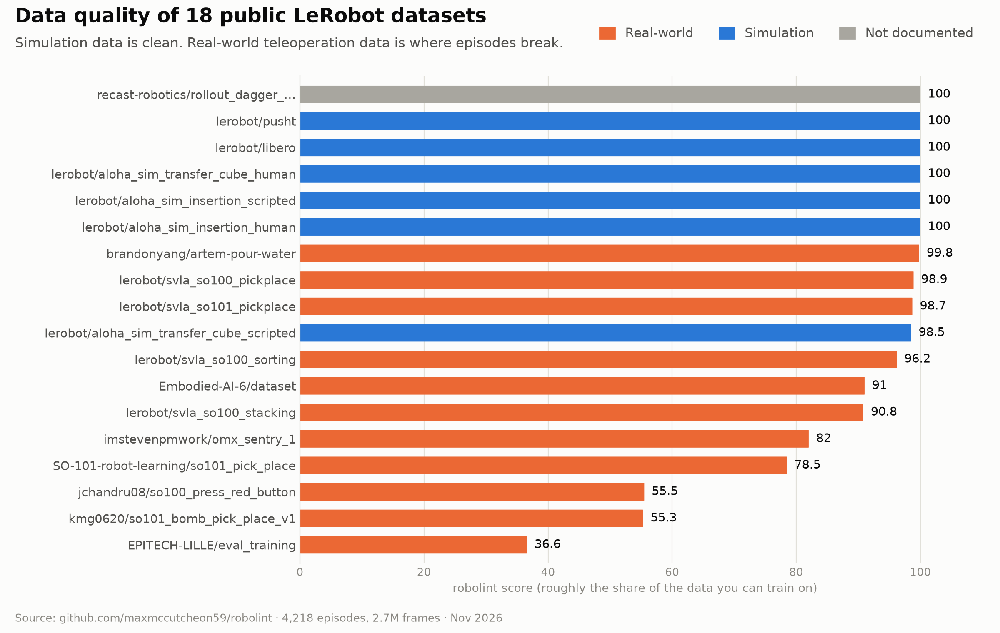

# robolint

[](https://github.com/maxmccutcheon59/robolint/actions/workflows/ci.yml)
[](https://github.com/maxmccutcheon59/robolint/blob/main/LICENSE)

**Quality checks for robot learning datasets.** Point it at any [LeRobot](https://github.com/huggingface/lerobot) dataset, local or on the Hugging Face Hub, and find out which episodes will quietly hurt your policy before you spend GPU hours training on them.

```bash
pip install "robolint[all]"
robolint check lerobot/svla_so101_pickplace --videos --html report.html
```

```text
robolint report: demo_ds
  format v3.0 · robot so101_follower · 40 episodes · 7,032 frames · 30.0 fps · cameras: observation.images.front

  Score 85.2/100  (grade B)
  clean episodes 30 (75%) · with warnings 5 (12%) · with errors 5 (12%)

  Issues
  error    DEAD_EPISODE               1 episode
           Commanded actions are constant. Drop the episode; it teaches the policy to do nothing.
  error    STATE_FROZEN               1 episode
           State never updates while actions change. Check the follower arm connection; drop the episode.
  error    VIDEO_BLACK                1 episode
           Camera shows black frames: lens cap, disconnect, or no light.
  warning  DUPLICATE_EPISODE          1 episode
           Nearly identical to another episode: duplicated upload or replay. ...
```

*(Output from a test dataset with deliberately injected faults.)*

**New: [What's broken in public robot learning data](https://github.com/maxmccutcheon59/robolint/blob/main/AUDIT.md)**, an audit of 18 public LeRobot datasets.

[](https://github.com/maxmccutcheon59/robolint/blob/main/AUDIT.md)

**Try it in your browser:** the [robolint Space](https://huggingface.co/spaces/maxmccutcheon59/robolint) checks any public LeRobot dataset without installing anything (experimental; no camera checks).

## Why

Robot data is expensive to collect and easy to get subtly wrong. A follower arm unplugs mid-session and you record minutes of actions with no motion. USB bandwidth drops camera frames and video drifts out of sync with actions. A teleop glitch makes a joint jump 150° in one step. An episode is uploaded twice. None of these crash training. They just make the policy worse, and nobody notices.

robolint finds them in seconds and tells you exactly which episodes to drop or fix.

## What it checks

| Area | Checks |
|---|---|
| **Timing** | dropped frames (timestamp gaps), timestamps going backwards, jitter, drift from declared fps, frame_index gaps and duplicates |
| **Actions & state** | NaN/inf values, dead episodes (robot never moves), frozen state (follower disconnected), teleop glitches (action spikes), idle lead-in/tail padding, gripper never actuating, **failed grasps** (the gripper closes on nothing: a failed demo) and recovered re-grasps, joints pinned at limits, **action-to-state lag** (the dataset's typical delay between command and measured state, and episodes whose delay is far off it) |
| **Episodes** | false starts, truncated and runaway episodes, metadata/data length mismatches, near-duplicate episodes, missing or unknown tasks |
| **Video** (`--videos`) | missing or unreadable files, **frames missing mid-episode** (gaps in the frame timestamps of every file, read without decoding), duplicate or out-of-order frame timestamps, video/action length mismatches, black, blown-out, blank, and frozen camera feeds, **frozen stretches mid-episode** (the image stops changing for a second or more while the joints that camera sees keep moving), fps and resolution mismatches in every file, **action/video sync** (each camera's typical delay behind the commanded motion, and episodes whose video is shifted in time against the actions) |
| **Columns** | split action and state columns (`action.left_arm` + `action.right_arm`) are found and joined; grippers can be named when the dimension names don't say "gripper" (see [Choosing columns](#choosing-columns)) |
| **Metadata** | declared vs actual episode/frame counts, missing features, shape mismatches, vague task descriptions that can't condition a VLA policy |


Every episode gets a 0–100 score and the dataset gets a score and letter grade (A ≥ 90, B ≥ 80, C ≥ 70, D ≥ 60). An **error** makes an episode unusable for training, so it scores 0; a **warning** keeps 85% of the score and **info** 98%. The dataset score is the average episode score, scaled down by dataset-level problems. The score is a summary of how many issues were found and how serious they are, not a measure of usable data or a prediction of training results; see [Scoring](#scoring).

Supports LeRobot **v2.x** (per-episode files) and **v3.x** (chunked files) layouts.

## Usage

```bash
# Local folder or Hub repo id
robolint check ./my_dataset
robolint check your-org/your-dataset --videos

# Shareable reports
robolint check your-org/your-dataset --json report.json --html report.html
# one-page audit for a team lead (prints to PDF)
robolint check your-org/your-dataset --audit-report audit.html --client "Your Team"
# grade badge for your dataset card
robolint check your-org/your-dataset --badge robolint.svg

# List bad episodes so you can drop them before training
robolint check your-org/your-dataset --exclude-out bad_episodes.txt
robolint check your-org/your-dataset --exclude-out flagged.txt --exclude-level warning

# Gate a data pipeline in CI
robolint check ./my_dataset --fail-under 85

# Spot-check a huge dataset: downloads only the files for the first N episodes
robolint check cadene/droid_1.0.1 --max-episodes 200

# Cap the decoded data kept in memory (default 512 MB); bigger datasets are streamed from disk
robolint check ./my_big_dataset --cache-mb 256

# Columns with other names: join split arms, name a gripper the dimension names don't reveal
robolint check ./my_dataset --action-key action.left_arm --action-key action.right_arm \
    --state-key observation.state.left_arm --state-key observation.state.right_arm
robolint check ./libero_style_dataset --gripper 6

# Audit many datasets at once
robolint audit lerobot/pusht lerobot/svla_so101_pickplace --out audit/
robolint audit --from-file datasets.txt --out audit/
```

From Python:

```python
from robolint import lint

result = lint("lerobot/pusht")
print(result.scores.dataset_score, result.scores.grade)
for f in result.findings:
    print(f.episode, f.severity.label, f.code, f.message)
```

Install options: `robolint` (local datasets), `robolint[hub]` (Hub downloads), `robolint[video]` (camera checks), `robolint[all]`.

## Choosing columns

robolint reads the action from a column called `action` and the measured state from
`observation.state`. When a dataset has no such column, it looks for split columns instead: every
numeric column under `action.` (for example `action.left_arm` and `action.right_arm` in a bimanual
recording) is joined side by side into one action, and the same for `observation.state.`. Parts
are ordered left before right, then by name, so action and state line up the same way. Each
joined dimension is named after its part, such as `left_arm.gripper.pos`, so grippers are paired
by name. The report says which columns were joined. A column called `actions` is also read as the
action. To choose the columns yourself, pass `--action-key` and `--state-key` once per column, in
the order to join them (`Config(action_keys=..., state_keys=...)` from Python).

The grasp, gripper and joint-limit checks find grippers by name: any dimension whose name contains
"gripper". When a gripper is called something else, or the dataset declares no dimension names at
all, name it with `--gripper`, by name or by 0-based index, once per gripper. The state's gripper
is taken to be the dimension with the same name, or at the same index when action and state have
the same width; `--state-gripper` names it otherwise. A gripper named this way is also left out of
the lag and video checks, which treat the other dimensions as joints. An unknown name or an index
out of range stops the run with an error (exit code 2).

## How the video checks work

Frame timestamps come from the container's packets, which are read without decoding, so every
frame of every file is checked. A gap of more than 1.5 frame periods inside an episode is
reported as missing frames. That is an error, because loaders that fetch frames by timestamp
(LeRobot does) fail or return the wrong frame there. Each file's frame rate is measured from the
regular spacing of its timestamps, so lost frames don't make a camera look slow.

Images are decoded sparingly. To find frozen stretches, about four frames per second are decoded:
only key frames when the encoding has them that often (LeRobot encodes every second frame as one),
otherwise the episode is decoded in full and sampled. For each camera, robolint fits how much the
image changes for a given movement of each joint, with non-negative weights, so joints that
camera does not see (the other arm of a bimanual robot, say) get no weight. It also measures how
much the image flickers when nothing moves. A stretch is flagged when, for at least a second, the
image changes less than that flicker while the joints the camera sees keep moving, and the same
camera is live elsewhere in the episode. The same fit stops the whole-episode frozen check from
flagging a camera when only joints it cannot see moved. When a camera's image change isn't
explained well by joint movement, or the dataset has no joints whose state follows the command,
frozen stretches are not looked for.

On a synthetic 24-episode bimanual recording with two cameras (AV1, sensor noise, pauses, one arm
often resting; `benchmarks/video.py`), `--videos` takes 11.8 s, against 10.9 s before this change. It finds
exactly the two injected faults and nothing else. Before, it missed both faults and wrongly
flagged 6 episodes as frozen. The same holds with a rendered (noise-free) image, sparse key frames
(H.264, every 2 s) and coarse encoding, except that the frozen stretch, which falls at the end of a
motion, is only caught when the camera has sensor noise.

## Large datasets

robolint does not load a dataset into memory. It reads each data file once to validate it and map
its rows to episodes, then decodes columns on demand while the checks walk the episodes, keeping
at most `--cache-mb` (default 512 MB) of decoded columns. Dataset-wide statistics (per-joint
ranges and glitch thresholds) are exact: quantiles are found in two passes from a sample and the
values near each answer, giving the same numbers as `numpy.quantile` without holding every value.
Memory is bounded by the cache, one data file and one episode, not by the size of the dataset.

Measured on synthetic 14-dimensional, 50 fps datasets (`benchmarks/scale.py`, one process per run):

| Frames | Parquet on disk | Peak memory before | Peak memory after | Time before | Time after |
|---|---|---|---|---|---|
| 500,000 | 61 MB | 777 MB | 435 MB | 13 s | 13 s |
| 2,000,000 | 240 MB | 2,160 MB | 567 MB | 58 s | 52 s |
| 10,000,000 | 1,197 MB | 7,281 MB | 1,115 MB | 320 s | 328 s |
| 10,000,000, `--cache-mb 128` | 1,197 MB | | 721 MB | | 416 s |

Before, memory grew by about 0.7 KB per frame, so 20 million frames needed about 14 GB. After, it
stops growing once the cache is full: the default 512 MB cache plus about 0.5 GB of working memory.
A smaller cache trades memory for time spent re-reading columns.

The findings and scores are identical before and after at every size, and on 69 synthetic
datasets covering every fault robolint detects (`benchmarks/corpus.py`, `benchmarks/compare.py`).

## Scoring

Each finding has a weight between 0 and 1 and keeps (1 − weight) of what it applies to. Each code
counts once per episode, at its worst severity.

| Finding about | error | warning | info |
|---|---|---|---|
| one episode | 1.0 (episode scores 0) | 0.15 | 0.02 |
| the whole dataset | 0.15 | 0.05 | 0 |

An episode starts at 100 and is multiplied by (1 − weight) for each finding, so one warning gives
85, two give 72.25, and warnings never add up to the 0 of an error. The dataset score is the
average episode score multiplied the same way by each dataset-level finding. A dataset-level
error, which is mostly metadata that no longer matches the data, costs as much as a warning on
every episode. `NO_ACTIONS` and `NO_EPISODES` leave nothing to train on, so they score the dataset
0. The JSON report lists the weights used (`score_weights`).

The weights are a judgment, not a measurement: nobody has yet shown how much each kind of issue
costs a trained policy. Change them to match what matters for your data, with `--weight` (CLI)
or `Config(score_weights=ScoreWeights(...))` (Python):

```bash
robolint check ./my_dataset --weight warning=0.25 --weight IDLE_PADDING=0.05 --weight dataset-error=0.3
```

On the 18-dataset audit, this scoring changes no grade; the 5 datasets with dataset-level
findings move by 0.6 to 7.4 points (`benchmarks/audit_scores.py` recomputes them from the
published findings).

## Exit codes

`0` success · `1` score below `--fail-under` · `2` dataset could not be loaded.

## Security

Datasets are treated as untrusted input: no pickle, no code execution, file paths from metadata are confined to the dataset folder, and every string in HTML reports is escaped. Report vulnerabilities to MaxMcCutcheon1@outlook.com.

## License

MIT © Max McCutcheon
