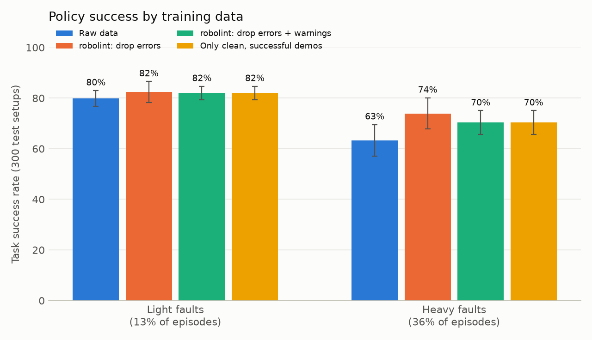

# Does filtering with robolint train a better policy?

A controlled study on a simulated pick-and-place task. It is a first test of the idea, not proof on real robots.

**Setup.** A scripted teleoperator records 200 demonstrations per dataset. A share of them is corrupted with the faults found in community LeRobot datasets: dead episodes, a disconnected follower (state frozen), teleop glitches (action spikes), long idle padding, and failed demos (the gripper closes short of the object, and the operator finishes the motion anyway). The follower gripper behaves like a real one: an object stops it partway, and it closes fully on air. Each dataset is saved in LeRobot v3 format and checked by robolint unchanged. The same behavior-cloning policy (an MLP) is trained on four versions of the data and evaluated on the same 300 held-out task setups, with 4 datasets × 3 training seeds per fault mix.

**Detection.** Across 1,208 clean episodes robolint flagged none. It caught 100% of dead episodes, frozen-state episodes and failed demos (as errors), and 100% of glitch and idle-padding episodes (as warnings).

**Results** (task success; paired differences across the 12 runs per mix):

| | Light faults (13%) | Heavy faults (36%) |
|---|---|---|
| Raw | 79.9% | 63.3% |
| robolint: drop errors | **82.4%** (+2.5, better in 9/12) | **73.9%** (+10.7, better in 9/12) |
| robolint: drop errors + warnings | 82.0% (+2.1) | 70.3% (+7.0) |
| Only clean, successful demos | 82.0% | 70.3% |

**What it says**
1. Dropping the episodes robolint marks as errors gives the best policy, up to +10.7 points of task success on heavily contaminated data.
2. Failed demos are the most damaging fault, and robolint now detects them from the gripper signal alone.
3. Dropping warning-level episodes does worse than keeping them: glitchy and padded episodes still hold good demonstrations. They should be repaired (trim idle frames, smooth spikes), not deleted.

**Limits.** A toy 2D task, a simple policy, fault rates chosen to resemble community data, and real run-to-run variance (paired standard deviation 5 to 10 points). The next step is the same comparison with a real policy (ACT or diffusion) on LeRobot sim tasks, and validating the failed-grasp check on real datasets.

Reproduce: `OMP_NUM_THREADS=1 python study.py` (under 2 minutes on 8 CPU cores; without `OMP_NUM_THREADS=1` the parallel workers each start a full set of BLAS threads and the run can be many times slower), then `python chart.py`.
